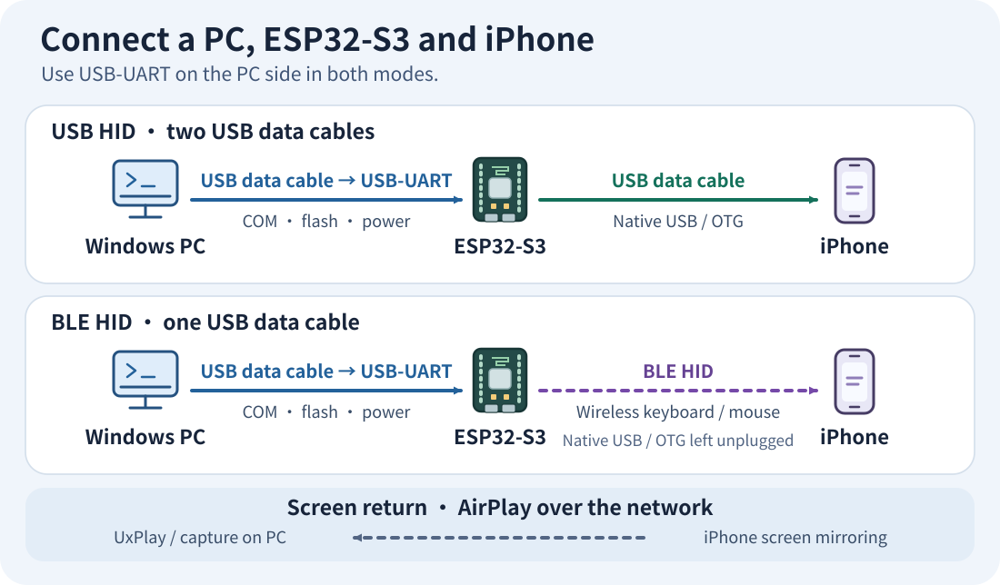
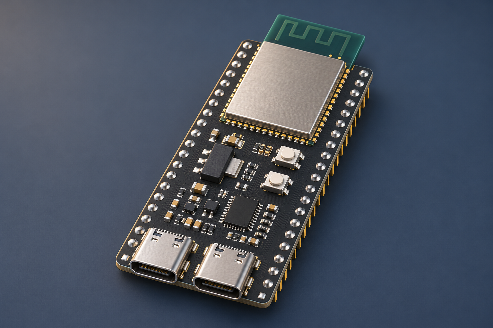

# iPhone Use

English · [简体中文](README.zh-CN.md)

Control a real iPhone from Windows through a **CLI or MCP**. An ESP32-S3 acts as a keyboard and mouse over **USB HID or Bluetooth LE HID**. AirPlay streams the iPhone screen back to the PC for screenshots. This setup uses built-in iPhone features and requires no companion app.

## What you can do

- **Operate apps** with taps, long presses, drags, and scrolling. Use coordinates from an unscaled screenshot to select a target.
- **Enter text and press keys** using the ESP32-S3 as a hardware keyboard.
- **See the phone screen** through AirPlay and take screenshots with the CLI or MCP. A still frame keeps its original timestamp, so you can tell whether it was captured after an action.
- **Use the same commands in wired or wireless mode.** The Windows PC always sends commands to the board over serial. You choose how the board sends input to the iPhone.

## Connect the two USB-C ports



Use an ESP32-S3 board with separate **USB-UART** and **native USB / OTG** ports. The verified setup uses an ESP32-S3-WROOM-1 module with 16 MB Flash and 8 MB PSRAM.

| Board port | Connect it to | When to use it |
| --- | --- | --- |
| **USB-UART** (USB-to-serial bridge) | **Windows PC**, using a USB data cable | Keep it connected for board power, firmware flashing, serial logs, and CLI/MCP commands. |
| **Native USB / OTG** | **iPhone**, using a USB data cable | Connect it for wired USB HID. For BLE HID it can stay unplugged; the ESP32 pairs directly with the iPhone. |

**For firmware development**, connect USB-UART to the PC first and leave the native port free. Close the CLI daemon or serial monitor before flashing so the flashing tool can open the port. To test USB HID, leave USB-UART connected to the PC and connect the native port to the iPhone with a second data cable. Keep a single host on the native USB link.

If the board has unclear labels, check its pinout or connect one port at a time and identify the **USB-to-serial bridge** in Windows Device Manager. Some native USB configurations also expose a COM port, so the presence of a COM number alone is insufficient. See [Espressif's port reference](https://docs.espressif.com/projects/esp-dev-kits/en/latest/esp32s3/esp32-s3-devkitc-1/user_guide_v1.1.html) for the two port roles.



*Original board illustration. Identify the ports by function and your board's markings.*

## Quick start on Windows

1. Set up the [Windows environment](doc/user/windows-setup.md), build the [serial HID firmware](hardware/serial_hid/README.md), and flash it through USB-UART. The build script only compiles.
2. Start the [AirPlay capture service](capture/README.md). On the iPhone, use Control Center → Screen Mirroring and select the configured receiver (typically `iPhone-Use`).
3. Wire the board for USB HID or pair `iPhone Use HID` on the iPhone under Settings → Accessibility → Touch → AssistiveTouch → Devices → Bluetooth Devices. Enable AssistiveTouch for pointer control. For BLE HID, select `ble` in the setup below.
4. From the repository root, build the CLI and check the connection. Use the COM number for the bridge on your PC.

```powershell
Push-Location cli
go build -o ../.runtime/bin/esp32agent.exe ./cmd/esp32agent
Pop-Location

$agent = ".\.runtime\bin\esp32agent.exe"
& $agent devices
$env:ESP32AGENT_PORT = 'COM24'                  # Replace with your USB-UART port.
$env:ESP32AGENT_HID_OUTPUT = 'usb'              # usb or ble
$env:ESP32AGENT_FRAME_URL = 'http://127.0.0.1:8892/frame'
& $agent device info
& $agent screenshot --output screen.png
```

For an MCP client, run the same executable with the `mcp` argument and pass it the same environment variables. When switching wired and BLE output, stop the current daemon with `esp32agent daemon stop` before changing `ESP32AGENT_HID_OUTPUT`. The [CLI guide](cli/README.md) lists commands and MCP tools.

## Hardware verification

Both HID outputs have been tested on physical hardware for clicking, scrolling, keyboard input, pressing, and dragging. BLE testing also covered operation with the iPhone USB cable unplugged and recovery after re-pairing. BLE input is rejected when the connection is unavailable. See the [dual HID results](hardware/serial_hid/doc/validation.md), [keyboard investigation](hardware/serial_hid/doc/usb-keyboard-shift.md), and [independent capture validation](doc/dev/reference-project-retirement.md) for the exact conditions and test limits.

## How it differs from upstream

This project builds on [ESP32 iPhone Agent](https://github.com/onehumanbeing/esp32-iphone-agent) by **Henry Yuan**. It uses Windows CLI/MCP with a serial command link, shared USB/BLE HID firmware, and an independent AirPlay capture service. The HID implementation separates pointer position, buttons, and scrolling and uses absolute coordinates. See the [firmware design](hardware/serial_hid/doc/usb-ble-hid.md) and [serial protocol](cli/doc/serial-control.md) for details.

Keep the upstream attribution in public demos, videos, and articles. See [LICENSE](LICENSE) and [NOTICE](NOTICE).
