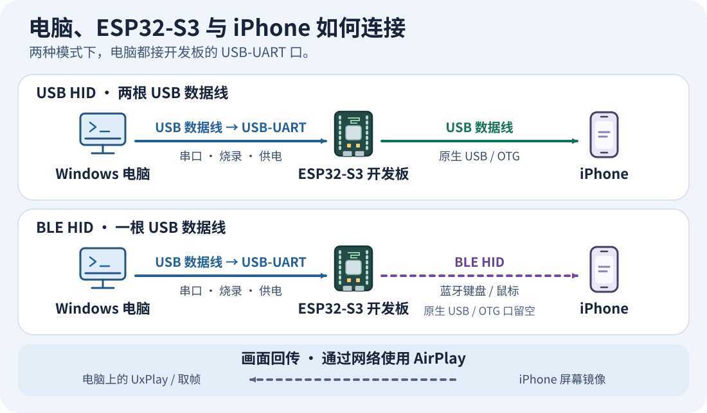
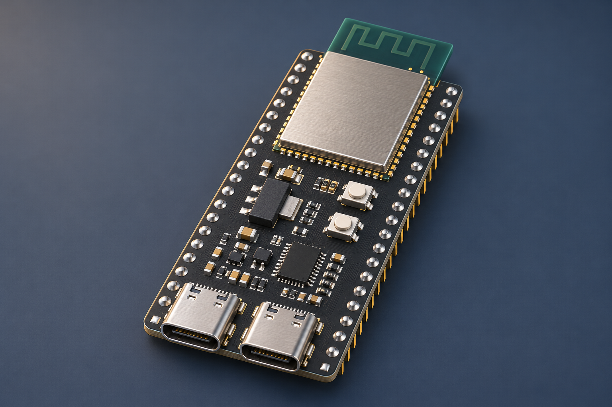

# iPhone Use

[English](README.md) · 简体中文

在 Windows 上通过 **CLI 或 MCP** 操作真实 iPhone。ESP32-S3 通过 **USB HID 或低功耗蓝牙 HID** 模拟键盘和鼠标。iPhone 通过 AirPlay 将画面传回电脑，供 CLI/MCP 截图。使用 iPhone 系统自带功能，无需安装配套 App。

## 可以做什么

- **操作手机 App**。支持点击、长按、拖动和滚动，可以按原始截图的像素坐标选择目标。
- **输入文字和按键**。ESP32-S3 作为外接键盘向 iPhone 发送输入。
- **查看手机画面**。可以通过 CLI 或 MCP 截图。静止画面保留原始采集时间，便于判断截图是不是在操作之后产生的。
- **有线和无线使用同一套命令**。Windows 始终通过串口把指令发给开发板，由你选择开发板如何把输入发给 iPhone。

## 两个 USB-C 口怎么接



需要一块带独立 **USB-UART** 和 **原生 USB / OTG** 端口的 ESP32-S3 开发板。实测用的是 ESP32-S3-WROOM-1 模组，16 MB Flash、8 MB PSRAM。

| 开发板端口 | 接到哪里 | 用途 |
| --- | --- | --- |
| **USB-UART**（USB 转串口） | 用 USB 数据线接 **Windows 电脑** | 日常保持连接，用于供电、刷固件、看串口日志和收发 CLI/MCP 命令。 |
| **原生 USB / OTG** | 用 USB 数据线接 **iPhone** | 测有线 USB HID 时接上。用 BLE HID 时可以留空，由开发板直接与 iPhone 蓝牙配对。 |

**开发和刷固件时**，先只接 USB-UART 到电脑，原生口留空。刷写前关闭 CLI daemon 或串口监视器，释放串口。测试 USB HID 时，保留电脑线，再用第二根数据线把原生 USB/OTG 接到 iPhone。原生 USB 链路一次只接一台主机。

端口标签不清楚时，查板子的引脚图，或一次只接一个端口，在 Windows 设备管理器确认哪一个是 **USB 转串口桥**。某些配置下，原生 USB 也会枚举出 COM 口，不能只凭 COM 编号判断。两类端口的功能可参考 [Espressif 的端口说明](https://docs.espressif.com/projects/esp-dev-kits/en/latest/esp32s3/esp32-s3-devkitc-1/user_guide_v1.1.html)。



*原创开发板示意图。接线时按端口功能和实物丝印辨认。*

## Windows 快速开始

1. 按 [Windows 环境说明](doc/user/windows-setup.md) 准备依赖，构建[串口 HID 固件](hardware/serial_hid/README.md)，通过 USB-UART 刷写。构建脚本只负责编译。
2. 启动 [AirPlay 取帧服务](capture/README.md)。在 iPhone 的控制中心打开「屏幕镜像」，选择已配置的接收器（通常为 `iPhone-Use`）。
3. 按有线模式接好 USB，或在 iPhone 的「设置 → 辅助功能 → 触控 → 辅助触控 → 设备 → 蓝牙设备」配对 `iPhone Use HID`。使用指针控制请开启辅助触控。用 BLE 时，将下面的输出模式改成 `ble`。
4. 从仓库根目录构建 CLI 并检查连接。COM 编号以本机 USB 转串口桥为准。

```powershell
Push-Location cli
go build -o ../.runtime/bin/esp32agent.exe ./cmd/esp32agent
Pop-Location

$agent = ".\.runtime\bin\esp32agent.exe"
& $agent devices
$env:ESP32AGENT_PORT = 'COM24'                  # 换成本机 USB-UART 串口。
$env:ESP32AGENT_HID_OUTPUT = 'usb'              # usb 或 ble
$env:ESP32AGENT_FRAME_URL = 'http://127.0.0.1:8892/frame'
& $agent device info
& $agent screenshot --output screen.png
```

MCP 客户端使用同一个可执行文件，传入 `mcp` 参数，并设置相同环境变量。切换有线和 BLE 前，先执行 `esp32agent daemon stop` 停止当前 daemon，再修改 `ESP32AGENT_HID_OUTPUT`。完整命令和 MCP 工具见 [CLI 指南](cli/README.zh-CN.md)。

## 实机验证

USB HID 和 BLE HID 均在真实设备上验证过点击、滚动、键盘、按压和拖动。BLE 也验证了拔除手机端 USB 线后的操作，以及重新配对后的恢复。BLE 未就绪时拒绝输入。具体条件及未覆盖范围见[双 HID 实测](hardware/serial_hid/doc/validation.md)、[键盘调查](hardware/serial_hid/doc/usb-keyboard-shift.md)和[独立取帧验收](doc/dev/reference-project-retirement.md)。

## 与上游项目的区别

本项目基于 **Henry Yuan** 的 [ESP32 iPhone Agent](https://github.com/onehumanbeing/esp32-iphone-agent)。目前由 Windows CLI/MCP 通过串口控制开发板，USB/BLE 复用同一套动作实现，画面由独立的 AirPlay 服务采集。HID 使用绝对定位，并将位置、按钮和滚轮分开。实现细节见[固件设计](hardware/serial_hid/doc/usb-ble-hid.md)和[串口协议](cli/doc/serial-control.md)。

公开演示、视频和文章请保留上游署名。见 [LICENSE](LICENSE) 和 [NOTICE](NOTICE)。
